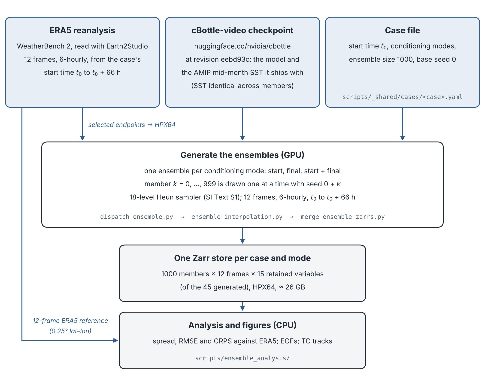

<!-- markdownlint-disable MD033 MD041 -->

# Extremes on Rewind

[](https://github.com/jerrylin96/rewinding-the-extremes/actions/workflows/signoff.yml)

Research code for **"Extremes on Rewind: Generating 1,000-Member Ensembles
Initialized at a Final Condition"** — Jerry Lin, Mu-Ting Chien,
Mansi Sakarvadia, and Elizabeth A. Barnes.

> [!IMPORTANT]
> **This is not NVIDIA Earth2Studio.** This repository is a *modified copy* of
> [NVIDIA/earth2studio](https://github.com/NVIDIA/earth2studio) (version
> `0.17.0a0`), extended with the ensemble-generation and analysis pipeline used
> for the paper above. Seven files in `earth2studio/` differ from upstream
> — see [Changes to the Earth2Studio library](#changes-to-the-earth2studio-library).
> It is an independent academic project, not affiliated with or endorsed by
> NVIDIA. For the library itself, use
> [the upstream repository](https://github.com/NVIDIA/earth2studio) and
> [its documentation](https://nvidia.github.io/earth2studio/) — not this fork.

## What this is

Planning for rare, high-impact weather usually means running a large
autoregressive ensemble forward and then sifting through it for the few members
that happen to produce the event of interest — a search that gets harder the
longer the lead time and the rarer the event.

This work takes the opposite approach. Using
[Climate in a Bottle](https://github.com/NVlabs/cBottle) video (cBottle-video),
a non-autoregressive generative model that samples an entire multi-day sequence
at once, we generate 1,000-member ensembles *conditioned on the final state* —
every member ends in the target extreme, and the ensemble spread describes the
antecedent conditions that could have led there. Ensembles are generated in
three conditioning modes (`start`, `end`, `both`) over 66-hour windows for three
cases: the 2021 Pacific Northwest heatwave, Superstorm Sandy, and Hurricane Ian.

## Repository layout

The research code lives outside the `earth2studio/` package:

<!-- markdownlint-disable MD013 -->
| Path | Contents |
|---|---|
| `scripts/ensemble_run/` | Ensemble generation — `dispatch_ensemble.py` submits one job per conditioning mode; `ensemble_interpolation.py` runs cBottle-video; `merge_ensemble_zarrs.py` consolidates member chunks. |
| `scripts/ensemble_analysis/` | Diagnostics and figures. Each `dispatch_*.py` fans out a `submission_scripts/compute_*.py` per case/mode, then `aggregate_*.py` reduces to the published figure. Covers spread/RMSE/CRPS, synoptic PCA, TC tracking, landfall splits, ageostrophic flow, power spectra, and free end states. |
| `scripts/_shared/` | Case definitions (`cases/*.yaml` — event windows, ensemble size, analysis regions) and shared figure helpers. See `scripts/_shared/README.md`. |
| `scripts/backward_emulator/` | Side-by-side comparison with the autoregressive backward emulator of [run-it-back](https://github.com/jerrylin96/run-it-back) on the same cases (survivor censoring, spread/RMSE/CRPS, free end states, synoptic PCA, ageostrophic flow, TC tracks); the figures of the NeurIPS 2026 CCAI workshop paper *Run it Back: Autoregression vs. Video Diffusion for Final-Conditioned Weather Trajectories* (Lin and Barnes 2026). See `scripts/backward_emulator/README.md`. |
| `scripts/download_era5_raw/` | ERA5 retrieval into local zarr stores for conditioning and verification. |
| `custom_utils/` | Ensemble loading, derived variables, interpolation, and diagnostic helpers. |
| `test/scripts/` | Tests for the analysis pipeline. |
<!-- markdownlint-enable MD013 -->

TC tracking uses [TempestExtremes](https://github.com/ClimateGlobalChange/tempestextremes)
with the Zarzycki & Ullrich (2017) configuration, driven by
`scripts/ensemble_analysis/tempest_extremes_runner.py`.

### A note on the job scripts

The `submit_*.sh` files are SGE (`qsub`) job scripts written for Boston
University's Shared Computing Cluster, and the `base:` paths in
`scripts/_shared/cases/*.yaml` point at that cluster's scratch filesystem.
They are included as a record of exactly how the published runs were executed;
adapt the scheduler directives and paths for your own system. The underlying
`compute_*.py` / `aggregate_*.py` scripts are plain Python and run anywhere.

## Regenerating the ensembles

The generated ensembles (about 240 GB) are not archived. They regenerate from
public inputs, each pinned:

<!-- markdownlint-disable MD013 -->

<!-- markdownlint-enable MD013 -->

- **ERA5**, read from WeatherBench 2 through Earth2Studio:
  `scripts/download_era5_raw/fetch_era5_zarr.py --year <year> --output_dir <dir>`
  writes one year as monthly zarr stores under `<dir>/<year>/`. Fetch every
  year a case touches, including the years of the stress tests' substituted
  final frames. Then change the default of `--data-path` in
  `scripts/ensemble_run/ensemble_interpolation.py` to `<dir>`: like the job
  scripts, it is set for our cluster, and the dispatcher does not pass it.
- **The cBottle-video checkpoint**, downloaded on first use from Hugging Face
  at the revision pinned in `earth2studio/models/px/cbottle_video.py`
  (`nvidia/cbottle@eebd93c`), together with the AMIP SST file it ships with.
- **The case file**, `scripts/_shared/cases/<case>.yaml`: the start time (the
  window runs 66 h from it), the conditioning modes, the ensemble size, the
  base seed and, for the stress tests, `custom_frames`. Set its `base:` to
  where the output should go.

Then, from `scripts/ensemble_run/` on a GPU cluster:

```bash
python dispatch_ensemble.py <case> --dry-run   # print the jobs first
python dispatch_ensemble.py <case>
```

For each conditioning mode this submits 20 jobs of 50 members and a merge job
that waits for them, and writes `<base>/<mode>/ensemble_f<frames>_n1000.zarr`
(about 26 GB) with `era5_reference.zarr`, the 12-frame ERA5 window on its
0.25° grid, beside it. Member *k* is drawn with seed `random_seed + k` (one
member per batch, the default), as described in Text S1 of the Supporting
Information. The three stress tests (`equator_indian_ocean`, `sandy_reversed`,
`texas_heat_to_freeze`) run the same way with start+final conditioning only
and 100 or 8 members. Seeds are fixed, but numerical results can vary across
GPU and software environments.

## Changes to the Earth2Studio library

Everything under `earth2studio/` is taken verbatim from upstream `0.17.0a0`
except the following seven files, modified or added for this work:

<!-- markdownlint-disable MD013 -->
| File | Change |
|---|---|
| `models/px/cbottle_interpolate.py` | **New.** Start/end-conditioned cBottle-video interpolation — the prognostic model this study is built on. |
| `models/dx/tc_tracking.py` | Adds the `TCTrackerMinMSL` tracker and `VARIABLES_TEMPEST_*` constants; renames tracker outputs to `tc_lat`/`tc_lon`/`tc_msl`/`tc_w10m`. |
| `models/dx/cbottle_infill.py` | Adds a `lat_lon_out` flag (default `True` preserves upstream behavior). |
| `lexicon/base.py` | Four additional `E2STUDIO_VOCAB` entries for the tracker outputs above. |
| `models/dx/__init__.py`, `models/px/__init__.py` | Export the components above. |
| `data/ufs.py` | Guards the `obstore` import, which is absent from this project's pinned environment. |
<!-- markdownlint-enable MD013 -->

`PORTING.md` tracks these divergences in more detail.

## Environment

The dependency set is deliberately frozen at the versions used for the
published runs (notably `torch` 2.9.1), so `pyproject.toml`, `uv.lock`, and
`requirements.txt` differ from upstream. See `installation_guide.md`
(or `installation_guide_mac.md`) for the full setup — briefly, into an active
conda environment:

```bash
uv pip install torch==2.9.1 --index-url https://download.pytorch.org/whl/cu128
uv pip install -e ".[utils,cbottle,cyclone,perturbation]"
python verify_env.py
```

## Citation

This code is archived at Zenodo:
[10.5281/zenodo.22000715](https://doi.org/10.5281/zenodo.22000715). If you use
it, please cite both the paper and the archive — `CITATION.cff` carries the
machine-readable metadata. Please also cite
[Earth2Studio](https://github.com/NVIDIA/earth2studio) and
[cBottle](https://github.com/NVlabs/cBottle) for the underlying software and
model.

## License

Apache License 2.0, inherited from NVIDIA Earth2Studio — see [LICENSE](./LICENSE)
for the full text. Original Earth2Studio code remains copyright NVIDIA
Corporation under that license; modifications and additions described above are
copyright their respective authors and released under the same terms.
